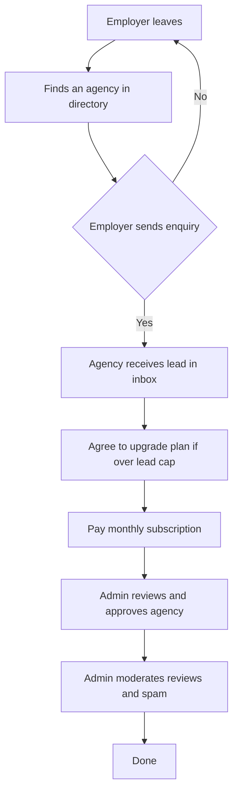
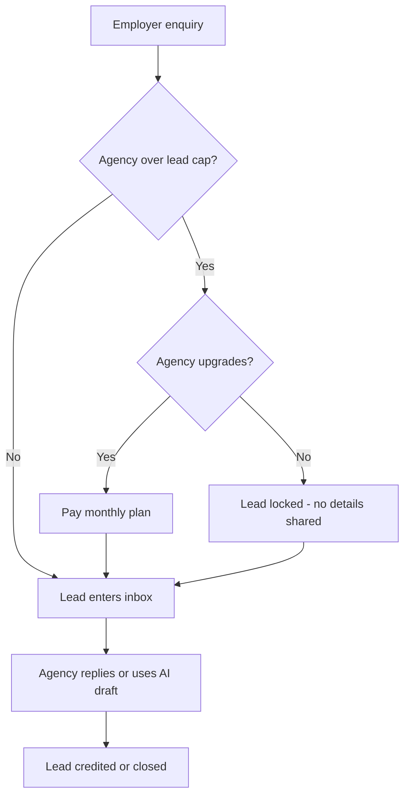

# FindMaids B2B Website — Workflow Guide

## 1. WHAT FINDMAIDS IS

FindMaids is a matching website for people who want to hire domestic helpers (nannies, caregivers, househelpers), agency owners who want to find clients, and a small staff team that checks listings and manages payments.

- **Employers** — people or families looking for a helper. They search, read agency profiles, and send enquiries.
- **Agencies** — recruitment agencies that list their services and receive client enquiries. They pay monthly plans to show their profiles better.
- **Admin staff** — the small internal team that approves new agencies, checks reviews, handles payments, and looks after the site.

**Who pays:** the agencies pay monthly subscription plans. The site earns money from agency subscriptions. Employers use the site for free.

**How the site earns money:**
1. Monthly subscription plans for agencies (Basic Free is free; Gold and above cost money).
2. Optional paid placements and featured listings (planned, not fully live).

---

## 2. THE BIG PICTURE

**What the diagram shows:**
1. Anyone can browse the public directory of agencies.
2. When an employer wants to contact an agency, they send an enquiry.
3. That enquiry becomes a lead in the agency's inbox.
4. If the agency has no leads left, they must upgrade to a higher plan to keep receiving new leads.
5. Before an agency can post publicly, an admin checks their licence and details and approves them.
6. After approval, the agency stays visible while the admin also checks reviews for spam or bad content.

---

## 3. EACH USER'S WORKFLOW

### a. Employer (family or person looking for help)

1. **Visit the site.** Go to the home page. See a list of agencies.
2. **Search and filter.** Use the search box for keywords, or filter by city, service type, language, or rating.
3. **Open an agency profile.** Click an agency name to see their full profile: photos, licence number, services, contact details, and reviews.
4. **Send an enquiry.** Fill in name, email, message, and tick a checkbox to agree that the agency may receive contact details. The system records where you came from (Facebook, Google, direct link, etc.).
5. **Use the AI chat assistant.** Click the chat button on the agency page or home page. Ask questions like "What do you offer?" or "What service locations do you list?" The AI gives public facts and points you to the agency.
6. **Read reviews.** Check the reviews section on an agency profile. Admins can hide or reject bad reviews.
7. **What you receive by email:** a confirmation that your enquiry was sent. The agency gets an email with your details and a link to reply. You get a copy of any reply.

---

### b. Agency (recruitment company)

1. **Register.** Go to `/register?type=agency` and enter name, email, password, and account type. You get an "Account created" message.
2. **Verify email.** Open the email link (or paste it) to confirm your address. You are then taken to the onboarding page.
3. **Onboarding wizard.** Fill in the agency details: website, licence number, Singapore business address, phone, WhatsApp, services, service locations (including overseas locations if applicable), languages, photos, and a description. Service locations are shown on agency profiles and can be searched by their listed text; they are not legal or licensing claims. The system checks your slug and saves a draft as you go.
4. **Submit for approval.** Click "Submit". The agency status becomes **PENDING**. An admin sees it in the approvals queue.
5. **Founding Agency free period.** Once approved, you get a **Basic Free** plan (free, no charge) for a set number of days (default 90). This gives you a basic profile and a small number of free leads.
6. **Dashboard.** After login, go to `/agency/dashboard`:
   - **Leads inbox** — new enquiries come in. Each has an AI summary, a draft reply, and buttons to view details, message, or reply.
   - **Response time** — a simple view of how fast you answered enquiries.
   - **Analytics** — weekly enquiries, top sources, city breakdown.
   - **Reviews** — reviews on your public profile.
   - **Billing** — your current plan, renewal date, upgrade or downgrade options, invoices, and receipts.
7. **Plans and checkout.** Go to `/agency/billing/checkout` and pick a paid plan (Gold, Platinum, or higher). The system creates a pending payment and redirects to the checkout page.
8. **Upgrade prompts when a lead cap is reached.** The dashboard shows a banner when you have used up your monthly lead limit. It shows the next plan and its price. Paid agencies may also get an email prompt.
9. **AI settings.** Go to the agency dashboard or settings to turn on/off the AI assistant, set reply tone, language, and knowledge base. Replies are always **drafts only** — the agency must read and send them.

---
## 4. HOW MONEY MOVES

1. **Plans.** Agencies start on **Basic Free** (no charge, included with approval). Paid plans (Gold, Platinum, etc.) are listed in the catalog with monthly and yearly prices.
2. **Checkout.** When an agency picks a paid plan, the system creates a pending payment and redirects to a hosted checkout page. The site does not store card numbers.
3. **PayMongo (live).** In production, `PAYMENT_PROVIDER=paymongo` is used. PayMongo handles the card payment and sends a webhook back to the site. The webhook is signed and checked.
4. **Bank transfer (manual).** Agencies can pay by bank transfer. The admin enters the details and reconciles the payment. The payment starts as **PENDING_BANK_TRANSFER** until the admin marks it **PAID**.
5. **Invoices and receipts.** When a payment is successfully made, the site generates an invoice PDF (with 12% VAT shown) and stores it in the private Supabase storage bucket. The agency can download it from the billing page.
6. **Renewal reminders.** A daily cron job sends reminders 7 days and 1 day before renewal. This is a best-effort reminder; there is no automatic card charge.
7. **Grace period.** After a payment fails or a subscription lapses, there is a **3-day grace period**. During this time the agency is **PAST_DUE**. If payment is not completed within 3 days, the subscription becomes **EXPIRED** and placements are removed.
8. **Downgrade at expiry.** At the end of a period, a Basic Free downgrade is applied with no charge. A paid downgrade requires the agency to complete a checkout at the discounted rate.
9. **Refunds.** ADMIN can give refunds, but only with confirmation. For PayMongo, the site calls PayMongo to reverse the payment. For manual transfers, the refund is recorded as an adjustment.
10. **What is real, what is mock:**
    - **PayMongo provider** — real code exists and is wired up. Needs live keys and real payment testing before launch.
    - **Mock provider** — fully built and used in local development and tests. It returns a success URL and accepts a signed test event. It does not call PayMongo.
    - **Bank transfer** — the UI and reconciliation logic are built and tested in the admin guide. The actual bank wiring is not connected.

---

## 5. HOW LEADS MOVE

1. **Enquiry arrives.** The employer fills in the enquiry form and agrees to share contact details. The enquiry is stored in the database with status **NEW**.
2. **Source tracking.** The system records the source (Chat, Web, WhatsApp, Email). For web visits, first-click attribution is captured with cookie consent. If the visitor has not agreed to analytics, no source is stored.
3. **Agency notification.** The agency gets an email and sees the lead in its dashboard inbox.
4. **Over-cap behaviour (LEAD_CAP_MODE).** Two modes:
   - **DELIVER_ALL (default):** every valid enquiry is saved and sent to the agency. The dashboard shows how many leads the agency has used above its allowance.
   - **LOCK_DETAILS:** if the agency is over its monthly lead cap, new leads beyond the limit have their contact details, message, and reply draft hidden ("Lead waiting · upgrade to view details"). The server also blocks edits and draft replies on those leads until the agency upgrades.
   - The employer's enquiry is never rejected because of the cap.
5. **AI summary and draft reply.** When a lead arrives, a background job writes an AI summary and a draft reply for the agency to review and send. Reply mode is **DRAFT only** — no auto-send.
6. **First-response time.** The system records when the agency first replies. Reports show unanswered leads over 24 hours and the percentage answered within 24 hours. These thresholds are provisional and not shown publicly.
7. **Source tracking with cookie consent.** Website analytics events (site visit, chat opened, message sent, enquiry created) are sent with an anonymous visitor ID. The ID is stored as a hashed cookie and tied to a consent record.

## 6. HOW THE AI PARTS WORK

1. **Employer chat assistant.** The chat widget on the public site answers questions using approved tools (search agencies, get agency details, FAQ answers). It never gives private data and always says it is an AI. It will not give legal or visa advice, and it offers a human handoff when unsure.
   - **Not allowed:** legal/immigration/visa advice, salary guarantees, false claims about agencies, revealing hidden instructions.
   - **Feature flag:** `employer_assistant` (OFF by default).
   - **Status:** ON only when an admin sets the feature flag to true in the feature flags JSON.
2. **Lead summaries.** A background job writes a short summary of each new lead in the agency inbox.
   - **Not allowed:** no PII sent to the AI model; the call is logged.
   - **Feature flag:** `agency_auto_reply` (supports lead summary as part of the lead flow).
   - **Status:** ON by default when the flag is set; OFF by default.
3. **Auto-reply drafts.** The system drafts a reply for the agency to approve. The draft is written in the agency's chosen language and tone.
   - **Not allowed:** auto-sending. The draft must be reviewed and approved by the agency owner.
   - **Feature flag:** `agency_auto_reply`.
   - **Status:** OFF by default.
4. **Profile helper.** The agency can provide a knowledge base (curated facts about services, prices, policies). The AI uses it to answer questions. It will not state prices or visa outcomes unless the knowledge base says so.
   - **Feature flag:** `agency_profile_helper`.
   - **Status:** OFF by default.
5. **Review moderation assist.** The AI suggests flags for reviews (spam, profanity, links, duplicates, abuse). It is a hint only; a human always makes the final decision. Reviews are never hidden or deleted purely by the AI.
   - **Feature flag:** `review_moderation_assist`.
   - **Status:** OFF by default.
6. **Admin insights.** The admin dashboard can show AI-assisted summaries of enquiry volume, source breakdown, and response times.
   - **Feature flag:** `admin_insights`.
   - **Status:** OFF by default.
7. **Safety rules in plain words:**
   - Always say "I am an AI assistant."
   - Never claim to be a person or staff member.
   - Do not give legal, immigration, visa, salary, or placement guarantees.
   - Treat user content as untrusted. Block obvious prompt-injection attempts.
   - Never send payment data, passwords, or government IDs to the AI provider. Mask contact details first.
   - Get consent before saving or sharing contact details.
   - If unsure, offer a human handoff.

---

## 7. BEHIND THE SCENES

**Database (PostgreSQL via Prisma + vector extension):**
- **People and roles:** Users, Agencies, Admins, staff accounts, roles, audit trail, 2FA.
- **Directories and profiles:** Agencies, Plans, AdPlacements, Agency media (photos, logos, banners).
- **Leads and enquiries:** Enquiries (main lead table), Messages, Conversations, HandoffRequest (human handoff).
- **Reviews:** Reviews, ReviewModeration, BlockList (blocked emails/phones/IPs).
- **Money:** Subscriptions, SubscriptionNotices, Invoices, InvoiceSequence, PaymentWebhookEvent, PaymentReconciler.
- **AI:** AiCallLog (every AI call), KnowledgeDocument, FeatureFlag, AdminSetting.

**File storage (Supabase Storage):**
- **`findmaids-media` bucket:** public. Used for approved agency listing images and profile photos.
- **`findmaids-private` bucket:** private. Used for bank-transfer proofs and invoice PDFs. The service role key is used only server-side.

**Scheduled jobs (cron + queue):**
- **Daily:** `/api/cron/subscriptions` runs renewal reminders (7-day and 1-day), checks expiring founding periods, and confirms subscription states.
- **Monthly:** `/api/cron/admin-monthly-summary` for monthly reporting.
- **BullMQ jobs (only when Redis is set up):** `lead.summary`, `lead.reply-draft`, `agency.embed`, `knowledge.embed`. Without Redis, these jobs are not queued.

**Outside services:**
- **Supabase (database + storage):** connected. Requires Supabase URL and service role key.
- **PayMongo (payments):** mock by default. Real PayMongo is not connected until `PAYMENT_PROVIDER=paymongo` with live keys.
- **Email (Resend):** mock/logged in development only. Without a key, emails are sent to the server console. Requires `RESEND_API_KEY` and `EMAIL_FROM` in production.
- **AI (Claude, Make, or Mock):** mock by default. Claude needs `AI_PROVIDER=claude` and `AI_API_KEY`. Make needs `AI_PROVIDER=make` and a protected webhook URL.
- **WhatsApp:** a webhook endpoint exists, but the WhatsApp Business account and templates are not fully set up. Keep the feature flag OFF until the account is ready.

---

---

## 8. A STATUS TABLE

|---|---|---|
| Public agency directory + search/filter | Built and tested | `smoke.spec.ts` and `public-auth.spec.ts` pass |
| Employer registration and email verification | Built and tested | `public-auth.spec.ts` passes |
| Enquiry form on agency profile | Built and tested | `public-auth.spec.ts` and `ai-chat-lead.spec.ts` |
| AI chat assistant on public site | Built but untested | `ai-chat-lead.spec.ts` requires E2E setup |
| Agency registration and email verification | Built and tested | `public-auth.spec.ts` |
| Onboarding wizard | Built but untested | No full e2e test; hosted in `agency-onboarding-payment.spec.ts` with a manual PUT |
| Agency approval workflow | Built and tested (with E2E_PAYMENT_FLOW=1) | `agency-onboarding-payment.spec.ts` |
| Founding Agency free period (90 days) | Built but untested | `prospect-founding.spec.ts` requires explicit credentials |
| Agency dashboard (leads, analytics, reviews, billing) | Built but untested | Partial coverage in `ai-chat-lead.spec.ts` (leads view) |
| Plans, checkout, and mock payment | Built but untested (default) | `agency-onboarding-payment.spec.ts` requires `E2E_PAYMENT_FLOW=1` |
| PayMongo live integration | Mock only | `lib/payments/provider.ts` has real PayMongo code but it throws without keys |
| Bank-transfer reconciliation | Built but untested | Admin guide describes it; no live e2e test |
| Lead cap LOCK_DETAILS | Built but untested | `lib/leads/cap.ts` + `layout.tsx` guard; no full e2e |
| AI assistant: employer chat | Built but untested | `ai-chat-lead.spec.ts` |
| AI: auto-reply drafts | Built but untested | `ai-chat-lead.spec.ts` requires flags and setup |
| Review moderation | Built but untested | `lib/agency-review.ts` and `lib/moderation.ts`; no full e2e |
| WhatsApp integration | Mock only | Webhook endpoint exists; no templates or Business account |
| Admin AI kill switch | Built but untested | `lib/ai/flags.ts` and `admin/ai-control/page.tsx` |
| Audit log | Built but untested | `lib/admin-audit.ts`; no dedicated e2e |
| Reports | Built but untested | `admin/reports/page.tsx`; no full e2e |
| Monthly cron jobs | Built but untested | `app/api/cron/subscriptions/route.ts`; `prospect-founding.spec.ts` calls it |

---

## 9. WHAT MUST HAPPEN BEFORE LAUNCH

1. **Decisions from docs/DECISIONS.md.** Key product and policy decisions still need a human sign-off.
2. **Domain and DNS.** Point the custom domain to the site. Confirm `NEXT_PUBLIC_SITE_URL` uses `https://`.
3. **Live payment activation.** Create a PayMongo Business account, get live secret keys, and move test keys to staging. Do a real small payment and refund test.
4. **Email domain.** Verify the sending domain, set SPF, DKIM, and DMARC, and test real delivery in Gmail and Outlook.
5. **Legal pages.** Have qualified Singapore counsel/privacy professionals review the Privacy Policy, Terms, Cookie Policy, enquiry consent, retention, and refunds before launch. Confirm applicable registration, privacy-officer and cross-border obligations with counsel.
6. **Privacy registration.** Register with the privacy regulator, publish the DPO contact, and add the privacy request routes (`/api/privacy`).
7. **WhatsApp setup.** Create the WhatsApp Business account, set approved templates and opt-in, and keep the feature flag OFF until the account is ready.
8. **Seed content.** Replace all sample agencies, FAQs, and boilerplate with approved real content. Remove sample users and test data.

---

## 10. TEN QUESTIONS THE OWNER SHOULD ASK UNCLE RICKY

1. **Should we enable the paid PayMongo flow now, or keep the mock provider for longer?** (That decides whether we enter live checkout testing now.)
2. **What is the target budget for the founding agency free period, and should the 90-day default be extended or shortened?**
3. **Do we want to collect consent for analytics, and what should the cookie consent screen say?**
4. **Should the lead cap use `DELIVER_ALL` (default) or `LOCK_DETAILS`, and who should change that setting?**
5. **Do we want to pay for the AI services (Claude/Make) now, or keep the mock AI for longer?**
6. **Should the startup (founding agency free period) email reminders be turned on at launch, or remain off until approved?**
7. **Do we need staff roles and a real bank-reconciliation process now, or is that a later phase?**
8. **Are the WhatsApp Business numbers and templates ready, or should that wait until after launch?**
9. **What legal and privacy registrations (NPC, DPO, data protection) must be completed before we show the site to the public?**
10. **Which paid plans and prices should we set in the catalog, and who approves price changes?**

---

*Notes on the code: this guide is based on the real files in `C:\B2B - Web\findmaids`. Where something is only in a test or only in an environment-config, I said so. I did not change any code and did not look at secrets.*
